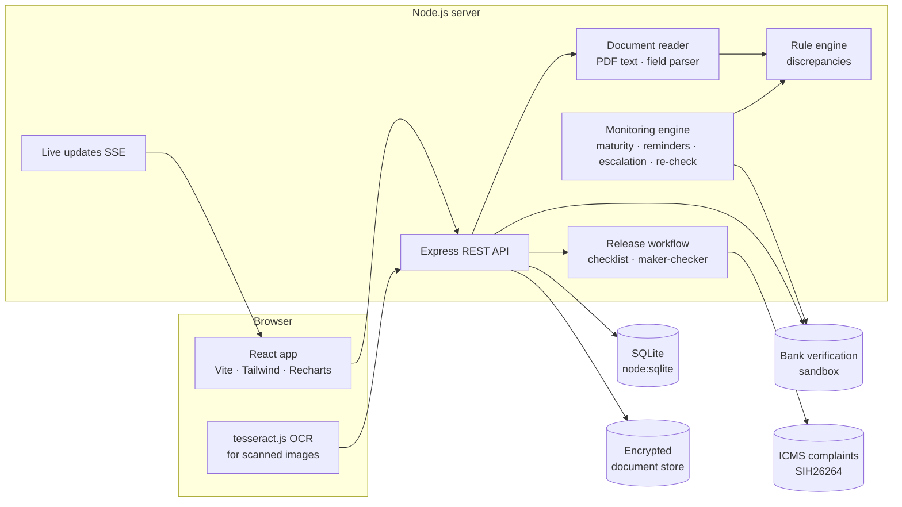

# AICTE Security Deposit / FDR Portal

**Smart India Hackathon 2026 · Problem Statement SIH26265 · AICTE / Regulation Bureau · Theme: Smart Automation · Team Varangians**

One portal where institutions submit their security deposits, FDRs and bank guarantees, the Regulation Bureau verifies them **against the bank's own record**, and the system watches every maturity date, chases renewals, escalates lapses and runs releases through a checklist and a maker-checker-approver chain. Every key field shows three values side by side: **what the institution declared, what the uploaded document says, and what the bank confirms**.

The full problem statement is in [docs/PROBLEM_STATEMENT.md](docs/PROBLEM_STATEMENT.md). How each requirement is met is in [docs/REQUIREMENTS_MAP.md](docs/REQUIREMENTS_MAP.md). A 7-minute walkthrough is in [docs/DEMO_SCRIPT.md](docs/DEMO_SCRIPT.md).

> **All data is synthetic.** No dataset came with the problem statement. Institutions, officials, deposits and bank records are generated and fictional. The bank verification service is a **simulated sandbox**. Requirement amounts and periods are illustrative and editable in *Administration → Requirement norms*.

---

## Quick start

Needs **Node.js 22.13 or newer** (Node's built-in SQLite, so no database to install).

```bash
npm run setup
```

```bash
npm run build && npm start
```

Open **http://localhost:4000**. The first start generates the demo database (under a second).

For development (API with auto-reload on :4100, Vite on :5180):

```bash
npm run dev
```

Other commands: `npm run seed` resets the demo data · `npm test` runs the end-to-end tests (9 scenarios) · `npm run build:demo` builds the browser-only demo for GitHub Pages.

### Demo accounts

Password for every account: **`Aicte@2026`**. The login screen lists them, one click each.

| Username | Role | Can do |
|---|---|---|
| `ms` | Competent Authority (Member Secretary) | Everything; approves releases; time machine; audit trail |
| `rb.director` | Director, Regulation Bureau | Verifies, accepts without bank confirmation (with reasons), waives non-critical discrepancies, checks releases (checker) |
| `rb.officer1`…`4` | Dealing officers, two regions each | Scrutiny, bank checks, queries, accept with bank confirmation, recommend releases (maker) |
| `accounts` | Accounts Officer | Confirms refund accounts, issues release letters |
| `auditor` | Internal audit | Read-only everything, audit trail and chain verification |
| `institution1`…`3` | Institution users | See only their own deposits; submit, renew, answer queries, request release |

---

## What it does

| Capability (from the statement) | Where |
|---|---|
| 1. Centralised SD/FDR repository, institution-wise and instrument-wise | **Register**, **Institutions → profile** (requirement vs holdings) |
| 2. Digital document management | Upload on **Submit**; documents panel on every instrument; encrypted at rest, SHA-256 fingerprinted |
| 3. Verification and discrepancy detection | **Three-way check** + **Discrepancies** on every instrument; **Check with bank** |
| 4. Automated validity and maturity tracking | Daily monitoring job; **Maturity calendar**; validity badges everywhere |
| 5. Renewal and replacement monitoring | **Submit renewal** links new to old; **Renewal history** chain |
| 6. Release and refund workflow | **Releases**: auto-checked conditions, officer → Director → Competent Authority → Accounts, release letter PDF |
| 7. Automated alerts and escalation | Reminder ladder T-90/60/30/15/7/0, overdue notices, 3-level escalation; **Alerts**; e-mail/SMS log |
| 8. Dashboard and management reports | **Dashboard** (active, expiring, matured, renewed, released, pending) and 10 **Reports** with CSV/print |
| 9. Audit trail and access control | Role-based access on the server; hash-chained audit log with one-click integrity check |
| 10. Integration and data security | Bank sandbox API; AICTE Permanent ID as the key; ICMS (PS SIH26264) complaint check before release; AES-256-GCM |

### The core idea: provenance per field

An FDR record is only as good as its source. The portal keeps three versions of each key field (instrument number, amount, dates, IFSC, depositor, lien):

1. **Declared**: what the institution typed.
2. **Document**: what the uploaded instrument actually says. Fields are read automatically: the PDF text layer of bank e-advices on the server, or OCR (tesseract.js) for scans, in the browser.
3. **Bank**: what the issuing bank's own books say, from the bank verification service (simulated here as a sandbox).

A record counts as **bank-confirmed** only when the bank confirmed it (online or by letter). Acceptance without bank confirmation needs the Director or the Competent Authority and a written reason, and stays labelled *officer-verified* everywhere. This is the statement's requirement to "distinguish between information submitted by an institution and information independently confirmed by an authorised bank".

### Discrepancy rules ([server/src/rules.js](server/src/rules.js))

| Rule | Severity | Catches |
|---|---|---|
| Bank record differs / not found / encashed / no lien | Critical | Altered or forged FDRs; deposits broken after acceptance |
| Duplicate instrument / reused file (SHA-256) | Critical | One FDR pledged for two approvals |
| Form ≠ document | Serious / warning | Typing errors, wrong document uploaded |
| Amount short, tenure short, type not accepted | Serious | Below the requirement norms |
| Not in favour of AICTE | Serious | Missing lien / wrong beneficiary |
| Invalid dates, IFSC/bank mismatch, depositor ≠ Trust | Warning | Data-quality problems |
| Missing prescribed documents | Warning | Covering letter, board resolution, bank letter |

Critical and serious findings block acceptance. Serious and warning findings can be waived by the Director with a recorded reason; critical ones cannot. Findings resolve themselves when the data is corrected.

### Monitoring ([server/src/engine.js](server/src/engine.js))

A daily, idempotent job:

- moves instruments to *Matured* on their maturity date;
- sends the **reminder ladder** (T-90, 60, 30, 15, 7, 0; SMS from T-15) while a renewal is still needed (the deposit must be held until the end of its holding period);
- after maturity, sends an **overdue notice** every 7 days and **escalates**: level 1 dealing officer (day 1), level 2 Director (day 15), level 3 Competent Authority with a final notice (day 30);
- **re-checks held deposits with the bank every 30 days**, which catches an FDR encashed after acceptance (two are planted in the demo data);
- keeps the alert list current: alerts appear and clear on their own.

All thresholds are editable in *Administration → Monitoring rules*. The **time machine** (*Administration*) moves the system date forward day by day, so judges can watch reminders, maturities and escalations happen.

### Measurable improvements

The dashboard computes, live from the records, what the statement asks the prototype to demonstrate. Migrated pre-portal records serve as the manual baseline:

- verification turnaround (median days) and % within the 7-day target;
- renewals received before maturity, portal vs manual;
- share of held deposits that are bank-confirmed;
- instruments stopped by critical checks and the amount at risk caught;
- notices sent automatically and the staff-hours they replace.

### Security

- scrypt password hashes, HMAC-signed 12-hour tokens, login throttling.
- Roles enforced on the server; institutions see only their own records (also on the live update stream).
- Documents **encrypted at rest** (AES-256-GCM) and fingerprinted (SHA-256); account numbers encrypted at field level and shown masked.
- **Tamper-evident audit trail**: each entry stores the hash of the previous one. *Administration → Audit trail → Verify the chain* recomputes it; a test edits an entry directly in the database and checks that the break is detected.
- Segregation of duties on releases: maker, checker and approver must be different people.

---

## Architecture



| Layer | Choice | Why |
|---|---|---|
| Frontend | React 19, TypeScript, Vite, Tailwind CSS 4, Recharts, TanStack Query | Typed, fast, responsive; light and dark themes |
| Backend | Node.js + Express 5 | One language end to end |
| Database | SQLite via Node's built-in `node:sqlite` | No setup; plain SQL ports to PostgreSQL |
| OCR | tesseract.js in the browser | No document leaves the user's machine for reading; no API key |
| Crypto | AES-256-GCM (Node), SHA-256 | Standard, auditable |

### Project layout

```
server/src/
  index.js        bootstrap, SSE, static hosting, hourly monitoring sweep
  routes.js       REST API
  instruments.js  submission, scrutiny, queries, acceptance, renewal, release workflow
  rules.js        discrepancy rules and the three-way comparison
  engine.js       validity, reminders, escalation, bank re-checks, alerts
  extract.js      PDF text extraction and FDR field parser
  bank.js         bank verification sandbox
  analytics.js    dashboard, KPIs, reports
  audit.js        hash-chained audit log
  vault.js        AES-256-GCM encryption · storage.js document store
  letters.js      instrument scans and release letters (PDF)
  samples.js      sample FDRs for trying the submission flow
  seed.js         synthetic data generator
  domain.js       instrument types, purposes, banks, requirement defaults, rules
server/test/      end-to-end API tests (node --test)
client/src/
  pages/          Dashboard, Desk, Register, InstrumentDetail, Submit, Calendar, Releases, ReleaseDetail,
                  Institutions, InstitutionDetail, InstitutionHome, Alerts, Reports, Admin
  demo/           browser stand-ins so the real server runs in the page (GitHub Pages demo)
docs/             problem statement, solution concept, requirements map, demo script
```

### Main API endpoints

| Method | Path | Purpose |
|---|---|---|
| POST | `/api/auth/login` | Sign in |
| GET | `/api/dashboard` | Categories, maturity profile, holdings, attention list, KPIs |
| GET | `/api/instruments?q&status&validity&type&purpose&bank&region&verification&issues&maturity_from&maturity_to&format=csv` | Register / export |
| GET | `/api/instruments/:id` | Instrument with three-way check, discrepancies, queries, history, lineage, documents, permissions |
| POST | `/api/extract` | Read fields from an uploaded document (or OCR text) |
| POST | `/api/instruments` | Submit (multipart: fields + documents); runs the bank check and rules |
| POST | `/api/instruments/:id/{bank-check,query,reply,fields,documents,verify,reject,release,note}` | Workflow |
| GET/POST | `/api/releases`, `/api/releases/:id/act` | Release workflow (check, recommend, forward, approve, release, return, resubmit, reject) |
| GET | `/api/reports/:name?format=csv` | 10 reports |
| GET | `/api/alerts`, `/api/events` | Alerts; live updates (SSE) |
| POST | `/api/admin/clock` | Demo time machine |
| GET | `/api/audit/verify` | Audit chain integrity |

---

## Demo data

`npm run seed` generates a deterministic data set in about 0.3 seconds:

- **320 institutions** in all 8 AICTE regions, with Trusts/Societies, approval status, open ICMS complaint counts and dues.
- **About 680 instruments** (FDRs, bank guarantees, online deposits) in renewal chains, across every status: pending, under query, active, maturing, matured, lapsed, renewed, release requested at every stage, released and rejected.
- **About 1,400 generated PDF documents** with a real text layer (FDR advices, covering letters, resolutions, bank letters, release letters).
- **Planted problems** for the demo: altered amounts, FDRs unknown to the bank, duplicates pledged by two institutions, no lien to AICTE, short amounts, form/document mismatches, missing documents, and two deposits encashed at the bank after acceptance.
- **A manual baseline**: records before the portal's go-live date are migrated legacy records with slower verification and later renewals, so the improvement figures have something to compare against.

## How the browser demo works

`npm run build:demo` builds the client in `demo` mode for GitHub Pages ([.github/workflows/pages.yml](.github/workflows/pages.yml) does this on every push to `main`, after the server tests).

- [client/src/demo/server.js](client/src/demo/server.js) starts the real server modules from `server/src` inside the page.
- [client/vite.config.ts](client/vite.config.ts) swaps the few Node-only pieces (`express`, `multer`, `node:fs`, database, encryption, file store) for browser stand-ins in [client/src/demo](client/src/demo), only for code under `server/src`.
- Data is saved in the visitor's browser (IndexedDB). Encryption is not applied there, since everything is already local.

## Production path

- PostgreSQL instead of SQLite (same SQL), AICTE SSO, HTTPS, keys in an HSM / key-management service.
- Bank verification through each bank's authorised service under a formal agreement, or RBI's **Account Aggregator** framework with the depositor's consent; banks without a service continue through confirmation letters. NeSL **e-Bank Guarantees** if AICTE accepts BGs.
- Institution master from the AICTE approval portal by Permanent ID; complaint status from ICMS (SIH26264); refunds through PFMS.
- E-mail/SMS gateway for the notices that are logged here; eSign on release letters.
